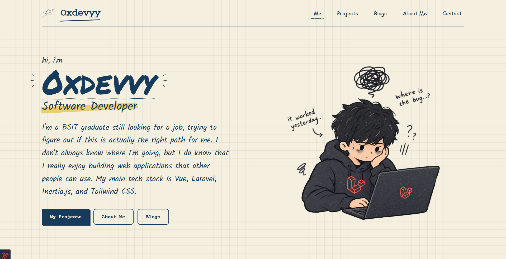
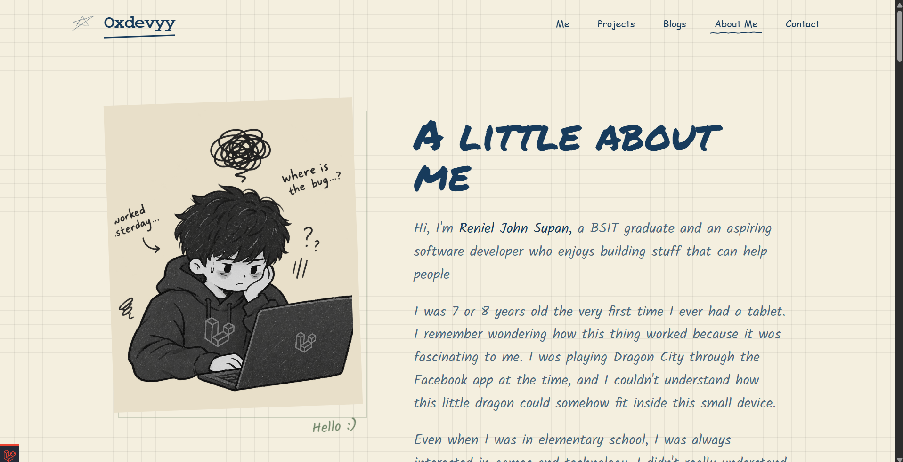
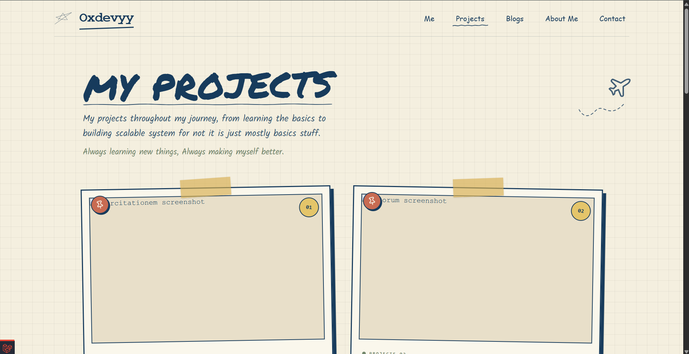
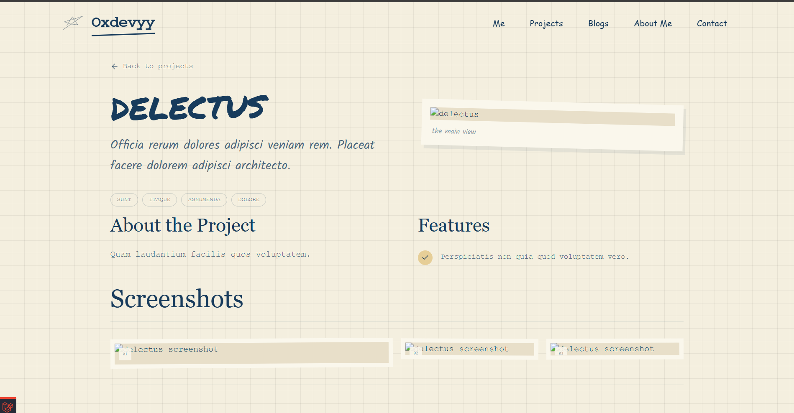
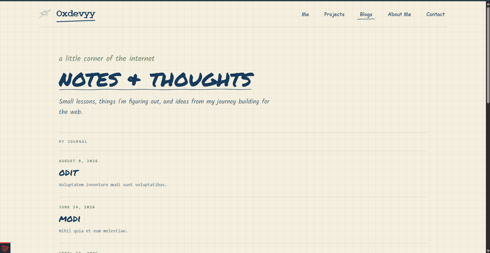
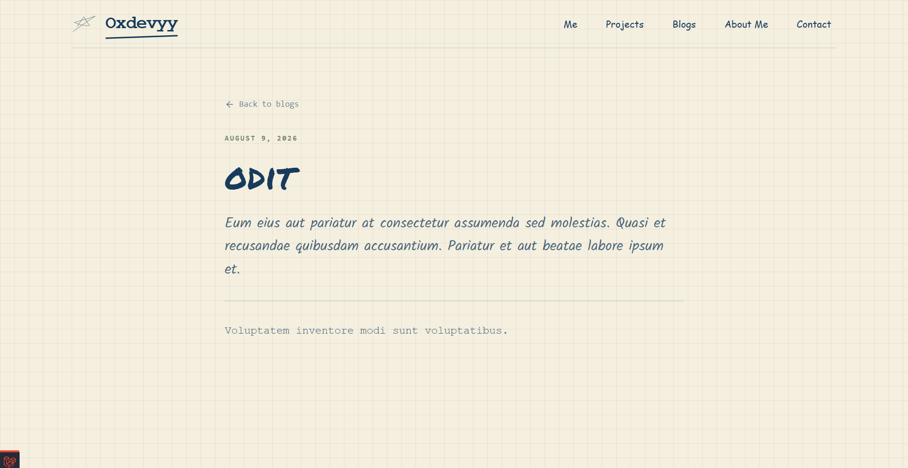
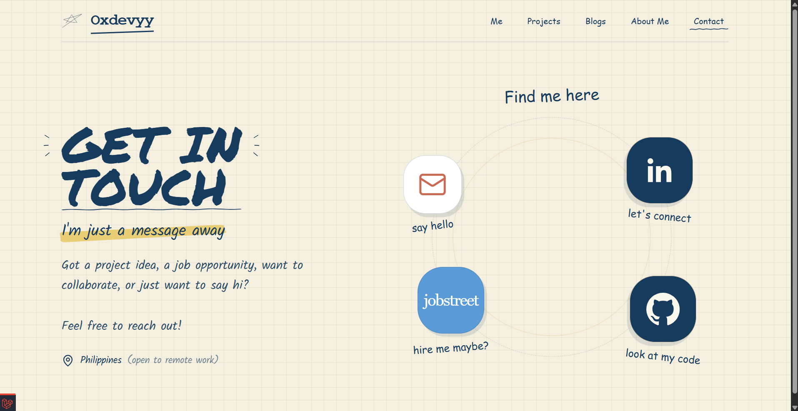
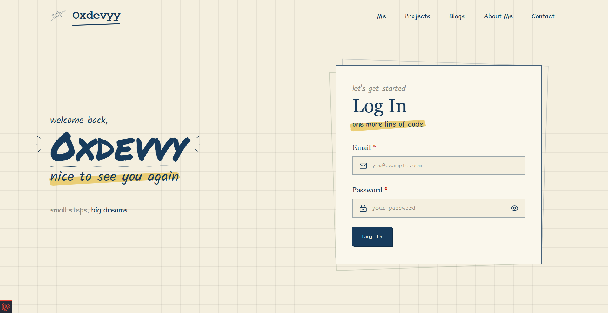
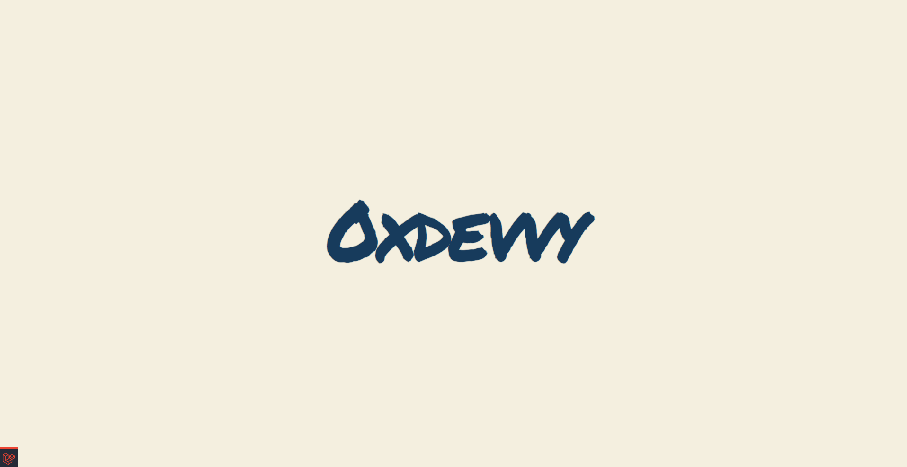

# 0xdevvyy Portfolio

A personal portfolio for showcasing projects, articles, and
making it easy to get in touch.


## What you can explore

- **Home and about pages** introducing the developer and the portfolio.
- **Project gallery** with project details, screenshots, and technology tags.
- **Blog** for browsing and reading articles.
- **Contact page** for getting in touch.
- **Private dashboard** for managing projects, blog posts, and tags.
- **Account settings** for changing the sign-in email and password.

## Screenshots

<div align="center">
  
  
  
  
  
  
  
  
  
</div>

## Built with

- Laravel 13 and PHP 8.5+
- Vue 3, TypeScript, and Inertia.js 3
- Tailwind CSS 4
- Vite

## Run locally

You’ll need PHP and Composer, Node.js and npm, and a database supported by
Laravel.

```bash
composer install
php artisan key:generate
php artisan migrate --seed
npm install
```

Create your `.env` from `.env.example` before generating the application key.
On Windows PowerShell:

```powershell
Copy-Item .env.example .env
```

On macOS or Linux:

```bash
cp .env.example .env
```

Configure your database in `.env` before running the migrations. For a local
SQLite setup, make sure `database/database.sqlite` exists and keep
`DB_CONNECTION=sqlite`.

Run these commands:

```bash
php artisan dev
```
it wil run both php artisan serve and npm run dev

Open the local URL printed by Artisan to explore the portfolio.


